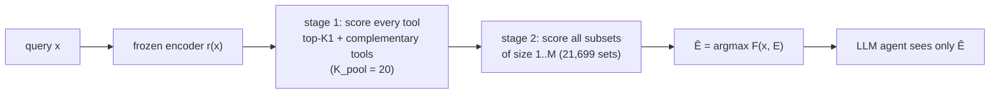

# hyset — set-level tool retrieval for LLM agents

[](LICENSE)
[](mise.toml)
[](https://arxiv.org/abs/2607.25718)

A runnable, clean-room proof of concept of **HySet**, from *"Tools Are Not Islands:
Set-Level Tool Retrieval for LLM Agents via Query-Conditioned Hyperedge Prediction"*
(Hong, Dong, Yu, Jiang, [arXiv:2607.25718](https://arxiv.org/abs/2607.25718)).

> Independent reimplementation. It is not affiliated with the paper's authors, and their
> code was not used (see [Clean room](#clean-room)).

An agent with thousands of tools can't put them all in its prompt, so a retriever picks
a few first. Most retrievers score each tool on its own and take the top-k. A travel
request then comes back with three flight APIs and no currency converter. HySet makes
the **tool set** the unit of retrieval: it scores whole candidate sets (hyperedges of a
tool co-invocation hypergraph) and hands the single best set to an unmodified agent.

What's in the box:

- **Method:** the HySet model, its training loop (InfoNCE over pools of negative sets,
  plus reward-weighted self-training), and exact two-stage inference (shortlist, then
  score all 21,699 subsets).
- **Data:** a synthetic tool world with planted set structure (decoy tools, implicit
  sub-tasks, cardinality-dependent co-invocation), plus a ToolBench converter.
- **Execution feedback:** via LangChain, with Claude (default) or a local Ollama model
  as agent and judge over mock tools. An offline `sim` reward covers demos and CI.
- **Interfaces:** a `hyset` CLI, an HTTP service (FastAPI), and an **MCP server**, so
  agents can call it as a pre-selection step.

## How it works

Each tool `t` has a learned unit vector `z_t`, initialized from a frozen text encoder's
embedding of its description. A candidate set `E` with `m` tools is scored as

```
F(x, E) =  Σ_{a<b ∈ E} z_aᵀ M_m z_b       +   Σ_{k ∈ E} softmax_k(ℓ) · ℓ_k,     ℓ_k = r(x)ᵀ P z_k
           └ co-invocation prior, one      ┘   └ attention-pooled query–tool alignment ┘
             symmetric matrix per set size
```

The interaction matrix depends on the set's size `m`. That lets "weather + currency"
be a strong pair inside a 4-tool trip plan and a weak pair on its own.



Training contrasts the annotated set with a pool of 63 negative sets. The pool mixes
random, in-batch, near-miss and model-mined sets. Optionally, rewards from running an
agent with the chosen set reinforce sets that actually work. The paper-to-code map,
every deviation from the paper, and the training findings are in
[`docs/DESIGN.md`](docs/DESIGN.md).

## Quickstart

Requires [mise](https://mise.jdx.dev). Everything else (Python 3.12, uv, the `.venv`)
is managed from `mise.toml`.

```bash
mise install
mise run setup        # uv sync --all-extras -> .venv
mise run test         # ~30 s, offline
mise run demo         # synth data, train (bge-small, CPU), evaluate, retrieve
```

`mise run demo` downloads `BAAI/bge-small-en-v1.5` (~130 MB) once and takes roughly
10-20 minutes on a 16-core CPU. For a quick no-download smoke run:
`uv run hyset demo --encoder hashing --epochs 2 --out runs/quick`.

## Results on the synthetic benchmark

Synthetic tool world (203 tools: 42 capabilities, 11 look-alike decoys, 150 fillers;
4,000 train / 400 val / 600 test queries, sets of 1-5 tools), frozen `bge-small-en-v1.5`,
CPU, seed 0, early stopping on validation Recall@5. Percentages. `set_*` columns score
the variable-size set Ê handed to the agent; `exec_sim` is the mean offline
simulated-execution reward of the set handed over (rankers hand over their top-5).

| method | Recall@5 | NDCG@5 | COMP@3 | COMP@5 | set exact | set ⊇ GT | set size | exec_sim |
|---|---|---|---|---|---|---|---|---|
| BM25 (top-k) | 43.6 | 39.7 | 8.3 | 15.0 | – | – | – | 17.8 |
| frozen bge-small (top-k) | 68.3 | 65.3 | 31.3 | 42.8 | – | – | – | 42.8 |
| same HySet params, per-tool top-k (stage 1) | 91.1 | 91.8 | 56.7 | 74.2 | – | – | – | 72.9 |
| **HySet** (mined negatives) | 92.4 | 92.6 | 61.5 | 82.0 | **48.5** | 52.5 | 2.35 | 64.7 |
| HySet + sim execution feedback | 92.7 | 92.8 | 61.8 | 82.3 | 47.5 | 52.5 | 2.42 | 64.7 |
| HySet, paper's 50/30/20 negative mix | 81.1 | 83.3 | 45.2 | 56.2 | 21.5 | 46.0 | 3.54 | 55.9 |
| ablation: shared M (no cardinality) | 93.5 | 94.3 | 63.3 | 86.7 | 22.2 | 24.7 | 1.69 | 41.4 |
| ablation: M_m = I | 92.1 | 92.4 | 60.0 | 83.2 | 4.3 | 62.7 | 5.00 | 59.5 |
| ablation: w/o F_set (per-tool scorer) | **97.1** | **97.1** | **69.7** | **91.5** | 8.7 | 8.7 | 1.00 | 23.1 |

On the paper's own motivating query ("…find round-trip flights, book a hotel near
Shinjuku, check the weather…, convert my 2,000 USD budget into yen"), the frozen
retriever's top-4 is *CheapFlights Deals, SkyRoute Flight Search, VisaCheck, FXRates* —
a decoy flight API and no hotel or weather — while HySet returns exactly
*{SkyRoute Flight Search, StayFinder Hotels, WeatherNow Forecast, FXRates Currency Converter}*.

What this does and does not show:

- **Reproduced:** training the set scorer beats untrained retrieval by a wide margin, and
  the **cardinality-specific** interaction matrices are what make variable-size set
  prediction work: exact-set match 48.5 vs 22.2 (shared M), 4.3 (M = I) and 8.7
  (no F_set); the alternatives pick sets that are systematically too small or too large.
- **Not reproduced:** the paper's claim that F_set also improves *ranking*. Here a
  fine-tuned per-tool scorer (the w/o-F_set ablation) ranks best, though its predicted
  set is always a single tool. On the 57 test queries whose tool combination never appears in
  training, HySet's COMP@5 (17.5) trails its own per-tool ranking (38.6): the learned
  co-invocation prior over-trusts familiar combinations (e.g. it drops weather from
  "convert 100 USD to euros and check the weather in Paris", a pair that is rare as a
  2-tool set). See `docs/DESIGN.md` §4 for why.
- **Small exact sets vs. a generous top-5 is unresolved.** Handing the agent the per-tool
  top-5 scores *higher* on simulated execution (72.9) than HySet's predicted set (64.7):
  the top-5 covers more sub-tasks, and the simulator only charges 0.05 per extra tool.
  Whether HySet's smaller sets pay off depends on how much distractor tools really hurt
  an agent — the paper measures that with a live agent (pass rate); this PoC has not.
- **Execution feedback** with the offline `sim` reward changes little here: it is nearly
  the same signal as the annotations. The paper reports its gains on agent pass rate.
- The paper's own negative mix trains noticeably worse on this data than adding
  model-mined negatives (the default here).

Reproduce (about 10-20 min per run on a 16-core CPU; runs can go in parallel with
`OMP_NUM_THREADS=4`):

```bash
uv run hyset synth data/synthetic
uv run hyset train data/synthetic runs/annot                       # HySet
uv run hyset train data/synthetic runs/demo --reward sim           # + execution feedback
uv run hyset train data/synthetic runs/paper-mix --neg-mix paper
uv run hyset train data/synthetic runs/shared-m --interaction shared   # also: identity, none
uv run hyset eval runs/annot
```

## Using it

```bash
uv run hyset synth data/synthetic                    # or: hyset toolbench <ToolBench/data> data/toolbench
uv run hyset train data/synthetic runs/demo          # --neg-mix paper|mined, --interaction cardinality|shared|identity|none
uv run hyset eval runs/demo                          # HySet vs stage-1 vs frozen dense vs BM25
uv run hyset retrieve -r runs/demo "Find flights to Tokyo, book a hotel near Shinjuku and convert 2,000 USD to yen"
```

Python:

```python
from hyset.run import Retriever

retriever = Retriever.load("runs/demo")
result = retriever.retrieve("convert my budget to yen and tell me what to pack for Tokyo")[0]
print([t.name for t in result.tools])      # the jointly scored tool set
print([t.id for t in result.ranking])      # set-aware ranking, for a fixed budget
```

### HTTP

```bash
uv run hyset serve runs/demo --port 8000
curl -s localhost:8000/retrieve -H 'content-type: application/json' \
     -d '{"query": "find a Thai restaurant near the harbor and get directions"}'
```

Endpoints: `POST /retrieve`, `POST /retrieve/batch`, `GET /tools`, `GET /tools/{id}`,
`GET /health`.

### MCP

`hyset mcp runs/demo` serves `select_tools(task, rank_k)` and `describe_tool(tool_id)`
over stdio (or `--transport streamable-http`). To register it with Claude Code:

```bash
claude mcp add hyset -- uv run --directory "$PWD" hyset mcp runs/demo
```

### Execution feedback (the paper's `L_self`)

```bash
# offline, free: simulated execution (capability coverage + noise)
uv run hyset train data/synthetic runs/sim --reward sim

# Claude as agent + judge over mock tools (needs ANTHROPIC_API_KEY; costs tokens)
uv run hyset reward-probe data/synthetic --n 2                       # sanity check first
uv run hyset train data/synthetic runs/claude --reward llm --reward-mode judge \
    --max-reward-calls 500 --agent-model anthropic:claude-opus-5-5

# local model via Ollama (ollama serve; agent mode needs a tool-calling model)
uv run hyset train data/synthetic runs/ollama --reward llm \
    --agent-model ollama:qwen2.5:7b --max-reward-calls 500
```

`--reward-mode judge` makes one judge call per (query, set); `agent` runs a tool-calling
rollout and then a judge call. `--max-reward-calls`, `--n-sub`, and `--refresh-steps`
bound spend (the paper's rollout cap, `N_sub`, and `T_ref`).

## Status and limitations

- PoC on CPU: synthetic data by default; the ToolBench converter is tested only on a
  fixture in ToolBench's format.
- The agent in the reward loop uses **mock** tools (no StableToolBench mirror), so the
  LLM reward measures "used the right capabilities", not real API success.
- The Claude / Ollama reward path is covered by tests with LangChain fake models only; it
  has not yet been run against a live API (`hyset reward-probe` is the first thing to try).
- Results are single-seed on synthetic data; the paper's ToolBench numbers are not
  reproduced here.
- Not yet: UltraTool, zero/few-shot splits, ToolEval pass rate, significance tests,
  cardinality calibration. See `docs/DESIGN.md` §3.

## Development

```bash
mise run lint      # ruff check + format check
mise run fmt       # auto-fix
mise run test      # fast suite, no downloads or network
mise run test:all  # also downloads the sentence-transformers model
```

Rules for contributors and coding agents are in [`AGENTS.md`](AGENTS.md): always mise
+ uv + `.venv`, the code layout, testing conventions, and gotchas. `CLAUDE.md` imports
it for Claude Code.

```
src/hyset/   model.py · inference.py · negatives.py · train.py · evaluate.py · metrics.py
             encoders.py · data.py · run.py · cli.py · baselines.py
             datasets/ (synthetic, toolbench) · reward/ (sim, llm, feedback) · serve/ (http, mcp)
tests/       pytest; brute-force checks of inference, Theorem 1, rewards, CLI/HTTP/MCP
docs/        DESIGN.md (put the paper PDF here locally; it is git-ignored)
examples/    preselect_then_act.py: HySet in front of a LangChain agent
```

## Clean room

The authors released MIT-licensed code at
[stormwther18/HYSET](https://github.com/stormwther18/HYSET). For this project, a
separate agent read that repository and wrote a functional spec: interfaces, data
formats, and default hyperparameters. The implementation here was written from the
paper and that spec only. No code was copied or adapted.

## Citation

If you use the method, cite the paper:

```bibtex
@article{hong2026hyset,
  title         = {Tools Are Not Islands: Set-Level Tool Retrieval for {LLM} Agents via
                   Query-Conditioned Hyperedge Prediction},
  author        = {Hong, Xinyi and Dong, Pinjun and Yu, Xinyang and Jiang, Binyan},
  journal       = {arXiv preprint arXiv:2607.25718},
  year          = {2026},
  eprint        = {2607.25718},
  archivePrefix = {arXiv},
  primaryClass  = {cs.LG}
}
```

## License

[MIT](LICENSE) for the code in this repository. The paper belongs to its authors and is
not redistributed here.
